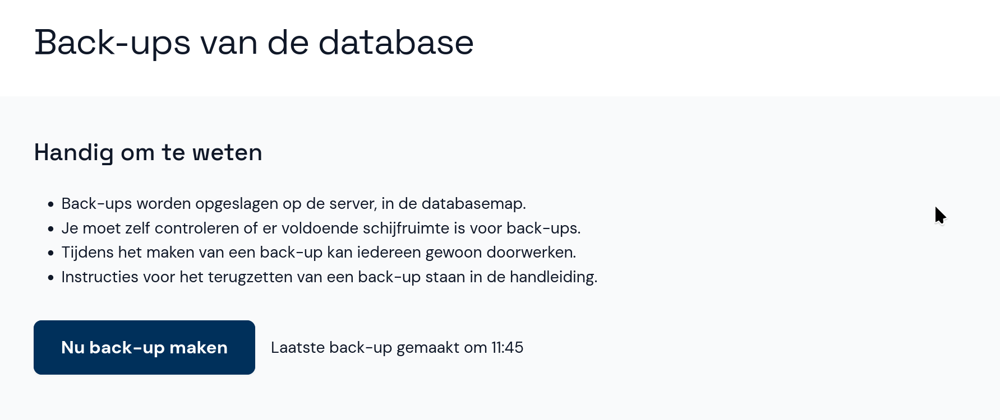

# Back-ups van de database

Abacus biedt de mogelijkheid om back-ups te maken van de database. Hiermee kun je dataverlies voorkomen.

## Back-up maken

- Ga in het hoofdmenu naar **Back-ups** en maak een back-up.

Op Windows wordt de back-up opgeslagen in de map `backups` in de gegevensmap van Abacus. Open deze map via de snelkoppeling **Abacus data** op het bureaublad.

Op Linux wordt de back-up opgeslagen in de map `backups` die wordt aangemaakt in de huidige werkdirectory van Abacus. Als je het [servicebestand](../installatie/linux.md#installeren) gebruikt is dat meestal dit pad:

`/var/lib/abacus`

## Back-up terugzetten

Als een bestand weer nodig hebt, kun je dit vanuit de back-uplocatie weer kopiëren naar de gegevensmap.

- Let erop dat er geen gebruikers ingelogd zijn en zorg dat de Abacus-service is gestopt. Instructies hiervoor vind je in de Instructies voor installeren en starten voor [Windows](../installatie/windows.md#beheren) en [Linux](../installatie/linux.md#beheren).
- Ga naar de gegevensmap en wijzig de naam van het databasebestand `db.sqlite` naar `db.sqlite.oud`.
- Ga via de gegevensmap naar de map `backups`.
- Back-upbestanden hebben de naam `db_backup_[datum-tijd].sqlite`. Kopieer het back-upbestand dat je wil terugzetten naar de gegevensmap.
- Wijzig de naam van het back-upbestand naar `db.sqlite`.

Daarna kun je Abacus weer starten en verdergaan met de invoer.
