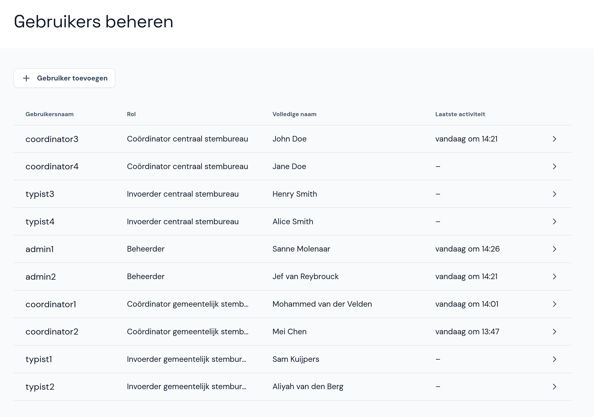

# Gebruikers beheren

Naast het toevoegen van de verkiezing en stembureaus voeg je ook (andere) beheerders, coördinators en invoerders toe. Kies hiervoor in het hoofdmenu **Gebruikers beheren**.

- Eerst selecteer je de rol van de nieuwe gebruiker: Beheerder, Coördinator of Invoerder. Dit kun je later niet meer aanpassen.
- Selecteer het type stembureau waarvoor de gebruiker een rol krijgt: *gemeentelijk stembureau (GSB)* of *centraal stembureau (CSB)*.
- Als de gebruiker een invoerder is, selecteer je eerst of het account op naam staat of anoniem is. Voor een anoniem account moet de gebruiker bij de eerste keer inloggen de volledige naam invoeren.
- Voer de gebruikersnaam, de volledige naam (behalve bij een anonieme invoerder) en een tijdelijk wachtwoord in. Bij de eerste keer inloggen moet de gebruiker het wachtwoord wijzigen.

## Gebruiker wijzigen of verwijderen

In hetzelfde menu kun je gebruikers ook wijzigen of verwijderen. Klik op de gebruiker en wijzig de gegevens of reset het wachtwoord. Je kunt de gebruiker ook verwijderen met de rode knop onderaan het scherm. De gebruikersnaam en de rol kunnen niet gewijzigd worden.
