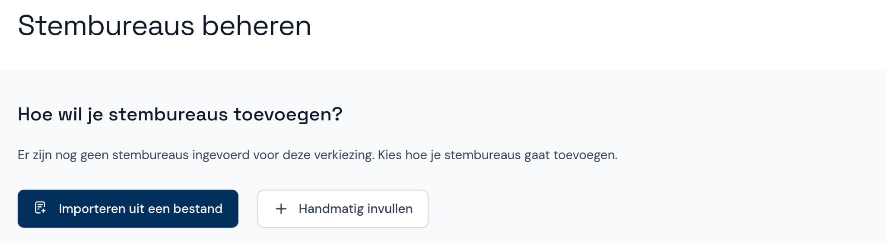

# Stembureaus beheren (gemeentelijk stembureau)

Wanneer je een verkiezing toevoegt voor het gemeentelijk stembureau zorg je ervoor dat de lijst met stembureaus correct is, zodat de stembureaus in Abacus overeenkomen met de stembureaulijst die voorafgaand aan de verkiezingen is gepubliceerd. Hieronder lees je hoe je stembureaus toevoegt, wijzigt en verwijdert.

## Stembureaus toevoegen

Als je een EML-bestand met stembureaus (EML 110b) hebt en dit nog niet hebt toegevoegd tijdens het toevoegen van de verkiezing, kun je dit nu importeren. Je kunt stembureaus ook handmatig toevoegen, aanpassen en verwijderen.

> <i class="fa-solid fa-circle-exclamation"></i> **Let op**  
> Een bestand importeren is niet meer mogelijk als er al stembureaus aanwezig zijn.

Als je een stembureau handmatig invult, voer je de gegevens van het stembureau in en geef je aan welke soort stembureau het is. Als het aantal kiesgerechtigden van het stembureau bekend is, kun je dit invullen, maar dat hoeft niet.

## Stembureau wijzigen of verwijderen

In het menu met stembureaus kun je stembureaus ook wijzigen of verwijderen. Klik op het stembureau en wijzig de gegevens, of verwijder het stembureau met de rode knop onderaan het scherm.

> <i class="fa-solid fa-circle-exclamation"></i> **Let op**  
> Als de invoerfase al is gestart, kun je de stembureaus niet meer wijzigen. Alleen een coördinator kan de lijst met stembureaus dan nog bewerken.
