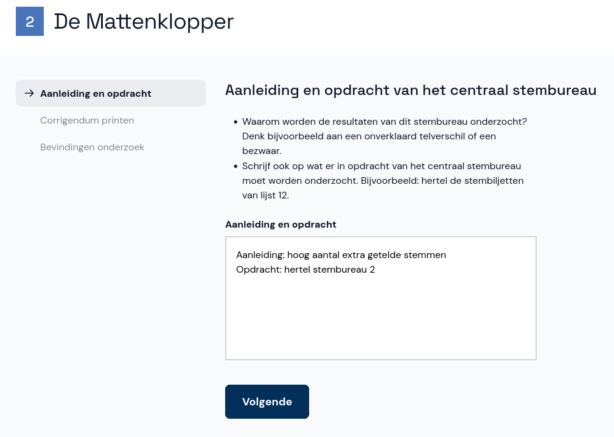

# Onderzoek toevoegen

In de nieuwe zitting klik je op **Aangevraagde onderzoeken** om een of meerdere onderzoeken toe te voegen.

Selecteer het stembureau waarvoor je een onderzoek wil toevoegen. Schrijf op wat de aanleiding is en welke opdracht het centraal stembureau heeft gegeven voor het onderzoek.

Nu kun je het corrigendum afdrukken en kan het onderzoek worden uitgevoerd volgens de instructies op het scherm. Als er meer onderzoeken nodig zijn, klik je op **Terug naar alle onderzoeken** om er nog een toe te voegen. Als je klaar bent kun je verder naar de bevindingen.

> <i class="fa-solid fa-circle-exclamation"></i> **Let op**
> In uitzonderlijke gevallen kan het nodig zijn dat je een onderzoek wil toevoegen voor een stembureau waarvoor in de eerste zitting geen resultaten zijn ingevoerd. Voeg het stembureau dan toe met de knop onderaan de lijst. Dit werkt op dezelfde manier als in de eerste zitting. Daarna ga je terug naar de nieuwe zitting en herhaal je de bovenstaande stappen.
