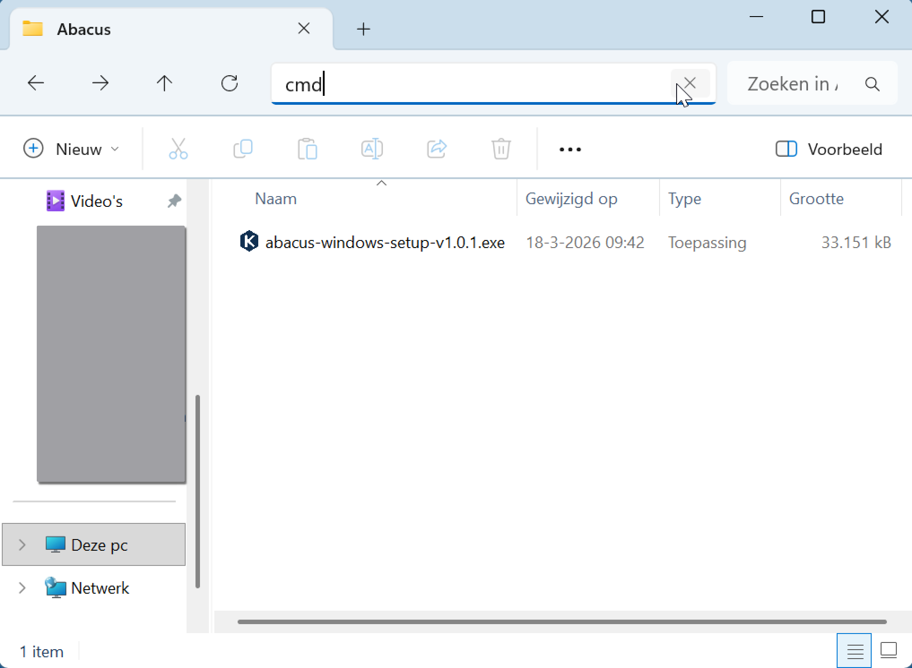
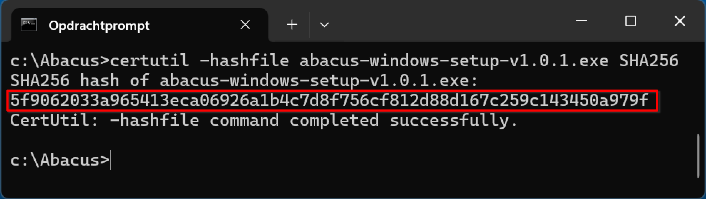
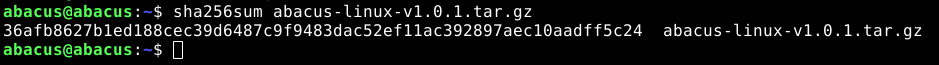

# Authenticiteit van Abacus vaststellen

Voordat je Abacus installeert, controleer je of de inhoud van het installatiebestand gelijk is aan de inhoud van Abacus zoals gepubliceerd door de Kiesraad.

Je vergelijkt de hashcode van het Abacus-bestand met de hashcode die op de website van de Kiesraad staat. De werkwijze om de hashcode te bepalen hangt af van je besturingssysteem.

Op de website van de Kiesraad vind je de hashcode van Abacus in de toolkit onder *Gebruik ondersteunende software*.

## Waarom is dit nodig?

Het is belangrijk om vast te stellen dat het installatiebestand van Abacus authentiek is. Als de hashcode overeenkomt weet je dat je de officiële, door de Kiesraad verspreide versie van Abacus installeert. Deze stap is een belangrijke waarborg waarmee we tot betrouwbare verkiezingsresultaten komen.

## Authenticiteit vaststellen op Windows

Op Windows toon je de hashcode met de opdracht `certutil`. In deze instructies gebruiken we hiervoor de opdrachtprompt. Als je liever PowerShell gebruikt, dan kan dat ook.

Ga in de Verkenner naar de locatie van het installatiebestand. Typ dan in de adresbalk van de verkenner `cmd` en druk op Enter. Hiermee open je de opdrachtprompt direct in de juiste map.



Voer vervolgens de volgende opdracht uit, waarbij `[versie]` de versie is van het Abacus-bestand:

```
certutil -hashfile abacus-windows-setup-[versie].exe SHA256
```

De hashcode staat onder de opgegeven opdracht. Deze hashcode controleer je met de hashcode die op de website van de Kiesraad staat. Als de hashcode identiek is, kun je Abacus installeren.


*Dit is een voorbeeld van de hashcode in de opdrachtprompt*

## Authenticiteit vaststellen op Linux

Voor Linux gebruik je de opdracht `sha256sum` in een terminal.

- Open een terminal en ga naar de locatie van het installatiebestand.
- Voer vervolgens de volgende opdracht uit, waarbij `[versie]` de versie is van het Abacus-bestand:

```
sha256sum abacus-linux-[versie].tar.gz
```

De hashcode staat vervolgens onder de opgegeven opdracht. Deze hashcode controleer je met de hashcode die op de website van de Kiesraad staat. Als de hashcode identiek is, kun je Abacus installeren.


*Dit is een voorbeeld van de hashcode in de terminal*

## Hashcode klopt niet

Klopt de hashcode niet? Controleer eerst of je het juiste installatiebestand met het juiste versienummer gebruikt. Als de bestandsnaam correct is, maar de hashcode nog steeds niet klopt, download het installatiebestand dan nog een keer en probeer het opnieuw.

Als je dit allemaal hebt geprobeerd en de authenticiteit van het installatiebestand nog steeds niet kunt vaststellen, neem dan contact op met de Kiesraad.
