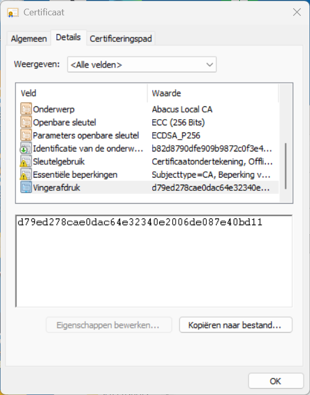
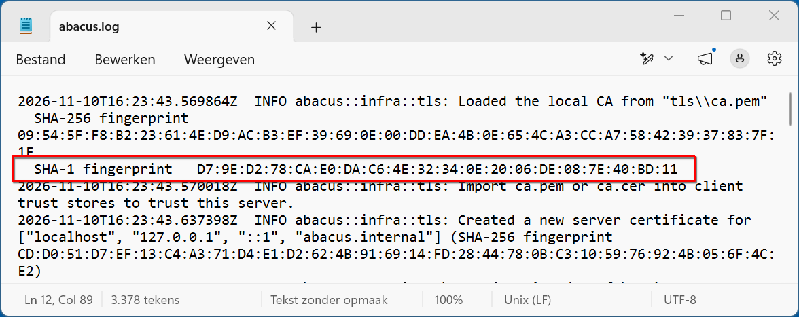

# Beveiligingscertificaat

Abacus gebruikt HTTPS en daarvoor is een TLS-beveiligingscertificaat nodig. Hiermee zet je een versleutelde verbinding op tussen de Abacus-server en de clients. Na de installatie van Abacus is het beveiligingscertificaat beschikbaar voor installatie in het besturingssysteem of in de gebruikte browsers.

Op **Windows** wordt het beveiligingscertificaat automatisch op de server geïnstalleerd tijdens de installatie van Abacus. Daarna installeer je het certificaat zelf op alle clients, zodat ze HTTPS gebruiken en een versleutelde verbinding hebben met de server.

Op **Linux** wordt het beveiligingscertificaat niet automatisch in het besturingssysteem geïnstalleerd. Installeer het certificaat dus op alle computers, inclusief de server.

> <i class="fa-solid fa-circle-exclamation"></i> **Let op**  
> Als je het certificaat in het besturingssysteem installeert, lukt het mogelijk niet om het certificaat in de browser te gebruiken. Firefox gebruikt bijvoorbeeld een eigen certificaatbeheerder. Als het nog niet werkt, installeer je het certificaat in de browser volgens de instructies hieronder.

## Certificaat kopiëren

Eerst kopieer je het certificaat naar de clients. Dit kun je op twee manieren doen.

### Via de browser

- Typ in de browser `http://[ip-van-Abacus-server]/ca.cer` (voor Windows) of `http://[ip-van-Abacus-server]/ca.pem` (voor Linux), dus bijvoorbeeld `http://192.168.1.10/ca.cer`, en druk op enter. Hiermee download je het certificaat direct van de Abacus-server.

> <i class="fa-solid fa-circle-exclamation"></i> **Let op**  
> Zorg dat je **http** typt, niet **https**. Met https probeert de browser het certificaat te herkennen terwijl je dit nog niet hebt geïnstalleerd.

### Via USB

- Ga naar het certificaatbestand op de server. Op Windows open je hiervoor de gegevensmap met de snelkoppeling **Abacus data** op het bureaublad en ga je naar de map `tls`. Op Linux staat het bestand in de map `/var/lib/abacus/tls`.
- Het bestand `ca.cer` is het certificaat voor Windows en webbrowsers, en het bestand `ca.pem` is het certificaat voor Linux.
- Kopieer het naar een USB-stick en vervolgens naar een handige map op de client.

> <i class="fa-solid fa-circle-exclamation"></i> **Let op**  
> Op Windows is de bestandsnaamextensie niet altijd zichtbaar. Klik op **Weergeven**, nogmaals op **Weergeven** en dan op **Bestandsnaamextensies** zodat je alle extensies kunt zien.

## Certificaat installeren op Windows

Eerst controleer je of de SHA-1-vingerafdruk van het certificaat klopt met de vingerafdruk die in het logbestand van Abacus staat. Zo weet je dat je het juiste bestand gebruikt en dat het niet is gewijzigd. Daarna installeer je het certificaat op de client.

### SHA-1-vingerafdruk controleren

Op Windows controleer je de SHA-1-vingerafdruk. Ga eerst naar de vingerafdruk van het certificaat:

- Dubbelklik op het beveiligingscertificaat en selecteer bovenaan het tabblad **Details**.
- In het venster selecteer je **Vingerafdruk**. De waarde zie je in het onderstaande veld.


*Dit is een voorbeeld van de SHA-1-vingerafdruk van het certificaat*

Ter controle vergelijk je deze vingerafdruk met de vingerafdruk in het logbestand. Die vind je zo:

- Op de server open je de gegevensmap via de snelkoppeling **Abacus data** op het bureaublad en ga je naar de map `logs`.
- Open het bestand `abacus` en zoek naar de regel *SHA-1 fingerprint*. De waarde staat op dezelfde regel.


*Dit is een voorbeeld van de SHA-1-vingerafdruk in het log van Abacus*

### Installeren op de client

Op de client sluit je eerst de browser. Ga naar het certificaatbestand en voer de volgende stappen uit:

- Dubbelklik op het beveiligingscertificaat en selecteer **Certificaat installeren...**.
- Selecteer **Lokale computer** en ga door. Bij de pop-up sta je toe dat het Windows-hostproces wijzigingen aan het apparaat aanbrengt.
- Selecteer **Alle certificaten in het onderstaande archief opslaan** en klik op **Bladeren...**.
- Selecteer **Vertrouwde basiscertificeringsinstanties** en bevestig dit. Nu kun je de wizard voltooien.

Nu open je de browser en controleer je of het werkt door naar https://[ip-van-Abacus-server] te gaan.

Let op: werkt het nog niet? Herstart de computer dan en open de browser opnieuw en ga naar het IP om te kijken of het werkt. Als het echt niet werkt, kun je het certificaat ook in de browser installeren.

## Certificaat installeren op Linux

Voor verschillende Linux-distributies bestaan meerdere manieren om het certificaat te installeren. Hier wordt alleen de methode voor Ubuntu beschreven.

### Installeren op de server en clients

Kopieer het certificaat naar de map `/usr/local/share/ca-certificates`. Vervolgens voeg je het certificaat toe aan de certificaatset van het besturingssysteem:

```
sudo update-ca-certificates
```

### SHA-256-vingerafdruk controleren

Ter controle vergelijk je de SHA-256-vingerafdruk van het certificaat met de SHA-256-vingerafdruk in het servicelog van de Abacus-service.

Met deze opdracht vind je de vingerafdruk van het certificaat `ca.pem`:

```
openssl x509 -in ca.pem -noout -fingerprint -sha256
```

En met deze opdracht vind je de vingerafdruk in het servicelog:

```
sudo journalctl -I -u abacus.service
```

## Certificaat installeren in de browser

Als een systeembrede installatie van het beveiligingscertificaat niet werkt, installeer je het certificaat in de browser die je gebruikt.

### Microsoft Edge

- Ga naar **Instellingen** → **Privacy, zoeken en services** → **Privacy** → **Certificaten beheren**.
- Selecteer **Door u geïnstalleerd**, selecteer naast **Vertrouwde certificaten** de optie **Importeren** en selecteer het bestand `ca.cer`.
- Selecteer **Openen** om het bestand direct te installeren.
- Ter controle vergelijk je de SHA-256-vingerafdruk in het grijze vak met de SHA-256-vingerafdruk die je in de command prompt ziet wanneer je de Abacus-server start.

### Google Chrome

- Ga naar **Instellingen** → **Privacy en beveiliging** → **Beveiliging** → **Certificaten beheren**.
- Selecteer **Geïnstalleerd door jou**, selecteer naast **Vertrouwde certificaten** de optie **Importeren** en selecteer het bestand `ca.cer`.
- Selecteer **Openen** om het bestand direct te installeren.
- Ter controle vergelijk je de SHA-256-vingerafdruk in het grijze vak met de SHA-256-vingerafdruk die je in de command prompt ziet wanneer je de Abacus-server start.

### Firefox

- Ga naar **Instellingen** → **Privacy en Beveiliging**. Helemaal onderaan de pagina selecteer je **Geavanceerde instellingen**.
- Onder **Certificaten** selecteer je **Certificaten beheren**. Selecteer **Importeren...** en selecteer het bestand `ca.cer`.
- Vink **Deze CA vertrouwen voor het identificeren van websites** aan.
- Selecteer **Weergeven** om de gegevens van het certificaat te bekijken in de browser.
- Ter controle vergelijk je de SHA-256-vingerafdruk met de SHA-256-vingerafdruk die je in de command prompt ziet wanneer je de Abacus-server start.
- Selecteer **OK** om het certificaat te importeren.

## Problemen oplossen

- Het kan voorkomen dat de browser op de client een foutmelding geeft nadat het certificaat is geïnstalleerd. Start de browser dan opnieuw. Als dit niet werkt, start je de computer opnieuw op.
- Als de netwerkconfiguratie wijzigt wanneer Abacus al is gestart, werkt het certificaat mogelijk niet goed meer op Windows. Herstart op de server dan de Abacus-service of start Windows opnieuw op, zodat Abacus het certificaat opnieuw kan aanmaken.
