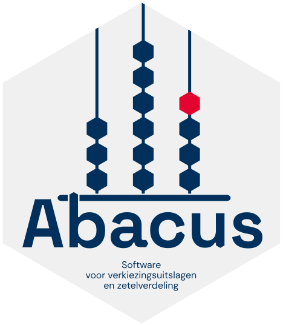

# Gebruikersdocumentatie Abacus

Welkom bij Abacus, software voor verkiezingsuitslagen en zetelverdeling. Dankjewel dat je onze software gebruikt!

Abacus vervangt op termijn de module Uitslagvaststelling van het programma Ondersteunende Software Verkiezingen (OSV2020-U). Bij de verkiezingen voor Provinciale Staten en waterschappen in 2027 gaan alle gemeentelijk stembureaus gebruikmaken van Abacus. Daarnaast gebruiken ook de centraal stembureaus van de waterschappen Abacus voor het controleren van de optellingen en het berekenen van de uitslag en de zetelverdeling.

Je gebruikt Abacus om de papieren processen-verbaal te digitaliseren en de tellingen te controleren, zodat tel- en schrijffouten kunnen worden gedetecteerd en voorkomen.
