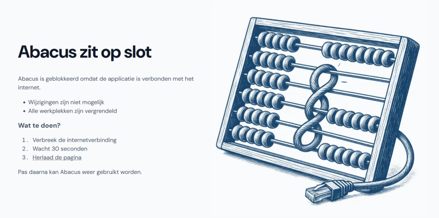

# Problemen oplossen

## Bekende problemen

Bekende problemen (of *known issues*) in versie 1.1 worden hier gedocumenteerd. We zijn op de hoogte van deze problemen en ze worden opgelost in een latere fase.

| Probleem | Oplossing |
|----------|-----------|
| Het EXE-bestand en de databasebestanden blijven bestaan als Abacus wordt verwijderd zonder eerst af te sluiten. | Sluit eerst Abacus af voordat je Abacus gaat verwijderen. |
| Coördinator: als je in een tweede of latere zitting een onderzoek hebt toegevoegd en dan teruggaat naar alle onderzoeken, geeft Abacus een foutmelding als je daarna de aanleiding voor het onderzoek probeert te wijzigen (via *Corrigendum afdrukken* naar *Aanleiding en opdracht*). | Verwijder het onderzoek voor dit stembureau en maak het opnieuw aan. |
| Coördinator: als je een aangemaakt onderzoek verwijdert en voor hetzelfde stembureau een nieuw onderzoek aanmaakt, kan het voorkomen dat Abacus een foutmelding geeft. | Zorg ervoor dat je het onderzoek niet onnodig verwijdert. Als je een fout hebt gemaakt bij het aanmaken van het onderzoek, kun je het onderzoek ook aanpassen. Heb je het onderzoek per ongeluk aangemaakt, verwijder het dan pas vlak voordat je het definitieve proces-verbaal gaat maken. Zo voorkom je de foutmelding in het geval er alsnog een onderzoeksverzoek voor het betreffende stembureau komt. |
| Coördinator: als je in een afgerond onderzoek de vraag *Is er een gecorrigeerde uitkomst?* hebt beantwoord met *Ja* maar verandert in *Nee* (of als je het onderzoek heropent), toont Abacus de volgende foutmelding: *Er zijn al gecorrigeerde telresultaten ingevoerd. Als je verder gaat worden deze verwijderd.* Dit gebeurt ook als het corrigendum nog niet is ingevoerd door de invoerder. | Als je deze waarschuwing ziet, vink de optie *Ga verder en verwijder de gecorrigeerde telresultaten* dan toch aan voordat je de pagina opslaat. De wijziging wordt dan correct verwerkt. |

## Problemen en oplossingen

Hier lees je voor elke rol welke problemen er kunnen ontstaan en wat de oplossingen zijn.

### Installatie

**Het EXE-bestand en de databasebestanden blijven bestaan als Abacus wordt verwijderd zonder eerst af te sluiten.**

Sluit eerst Abacus af voordat je Abacus gaat verwijderen.

**Abacus is geblokkeerd omdat de applicatie is verbonden met het internet.**

Controleer de netwerkverbindingen in het hele netwerk en schakel alles uit. Let ook op dat alle bluetooth-verbindingen uit staan en de printer (indien aanwezig) geen verbinding heeft met het internet. Wanneer de internetverbinding verbroken is, wacht je 30 seconden en herlaad je de pagina door op de link <ins>Herlaad de pagina</ins> te klikken.

### Beheerder

**Abacus is geblokkeerd omdat de applicatie is verbonden met het internet.**

Controleer de netwerkverbindingen in het hele netwerk en schakel alles uit. Let ook op dat alle bluetooth-verbindingen uit staan en de printer (indien aanwezig) geen verbinding heeft met het internet. Wanneer de internetverbinding verbroken is, wacht je 30 seconden en herlaad je de pagina door op de link <ins>Herlaad de pagina</ins> te klikken.

### Coördinator GSB

**Abacus is geblokkeerd omdat de applicatie is verbonden met het internet.**

Geef dit door aan de beheerder. Die controleert de netwerkverbindingen en schakelt alles uit. Wanneer de internetverbinding verbroken is, wacht je 30 seconden en herlaad je de pagina door op de link <ins>Herlaad de pagina</ins> te klikken.

**Als je in een tweede of latere zitting een onderzoek hebt toegevoegd en dan teruggaat naar alle onderzoeken, geeft Abacus een foutmelding als je daarna de aanleiding voor het onderzoek probeert te wijzigen (via *Corrigendum afdrukken* naar *Aanleiding en opdracht*).**

Verwijder het onderzoek voor dit stembureau en maak het opnieuw aan.

**Als je een aangemaakt onderzoek verwijdert en voor hetzelfde stembureau een nieuw onderzoek aanmaakt, kan het voorkomen dat Abacus een foutmelding geeft.** 

Zorg ervoor dat je het onderzoek niet onnodig verwijdert. Als je een fout hebt gemaakt bij het aanmaken van het onderzoek, kun je het onderzoek ook aanpassen. Heb je het onderzoek per ongeluk aangemaakt, verwijder het dan pas vlak voordat je het definitieve proces-verbaal gaat maken. Zo voorkom je de foutmelding in het geval er alsnog een onderzoeksverzoek voor het betreffende stembureau komt.

**Als je in een afgerond onderzoek de vraag *Is er een gecorrigeerde uitkomst?* hebt beantwoord met *Ja* maar verandert in *Nee* (of als je het onderzoek heropent), toont Abacus de volgende foutmelding: *Er zijn al gecorrigeerde telresultaten ingevoerd. Als je verder gaat worden deze verwijderd.* Dit gebeurt ook als het corrigendum nog niet is ingevoerd door de invoerder.**

Als je deze waarschuwing ziet, vink de optie *Ga verder en verwijder de gecorrigeerde telresultaten* dan toch aan voordat je de pagina opslaat. De wijziging wordt dan correct verwerkt.

### Coördinator CSB

**Abacus is geblokkeerd omdat de applicatie is verbonden met het internet.**

Geef dit door aan de beheerder. Die controleert de netwerkverbindingen en schakelt alles uit. Wanneer de internetverbinding verbroken is, wacht je 30 seconden en herlaad je de pagina door op de link <ins>Herlaad de pagina</ins> te klikken.

### Invoerder

**Abacus is geblokkeerd omdat de applicatie is verbonden met het internet.**

Geef dit door aan de coördinator. Die overlegt met de beheerder om dit probleem op te lossen. Wanneer de internetverbinding verbroken is, wacht je 30 seconden en herlaad je de pagina door op de link <ins>Herlaad de pagina</ins> te klikken.

**Ik kan geen getallen invoeren met het toetsenblok aan de rechterkant van het toetsenbord.**

Druk op de **Num**- of **Num Lock**-toets op het toetsenblok. Je kunt het toetsenblok dan weer gebruiken.
