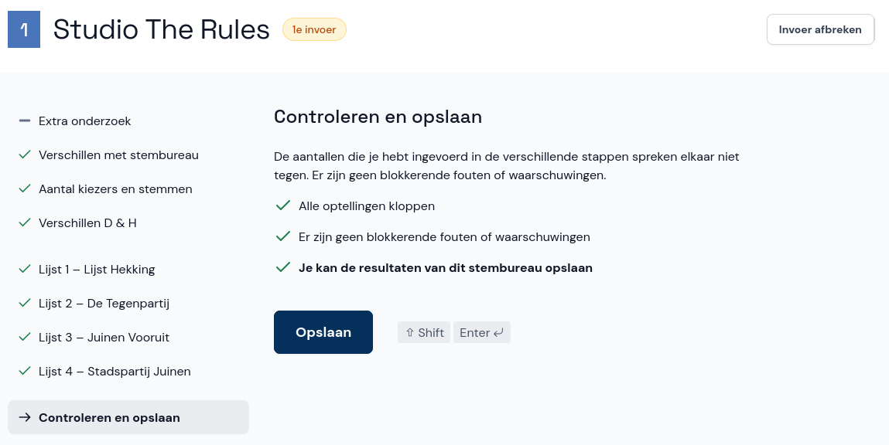

# Afronden

Heb je de laatste lijst ingevoerd en zijn er geen fouten of waarschuwingen, of heb je eventuele fouten en waarschuwingen besproken met je coördinator? Dan kan je de resultaten van het stembureau opslaan.

Wanneer de invoer is opgeslagen, geef je het proces-verbaal terug aan de coördinator. Als je nog een stembureau wil invoeren, kun je direct een ander stembureaunummer invullen of een stembureau uit de lijst kiezen.
