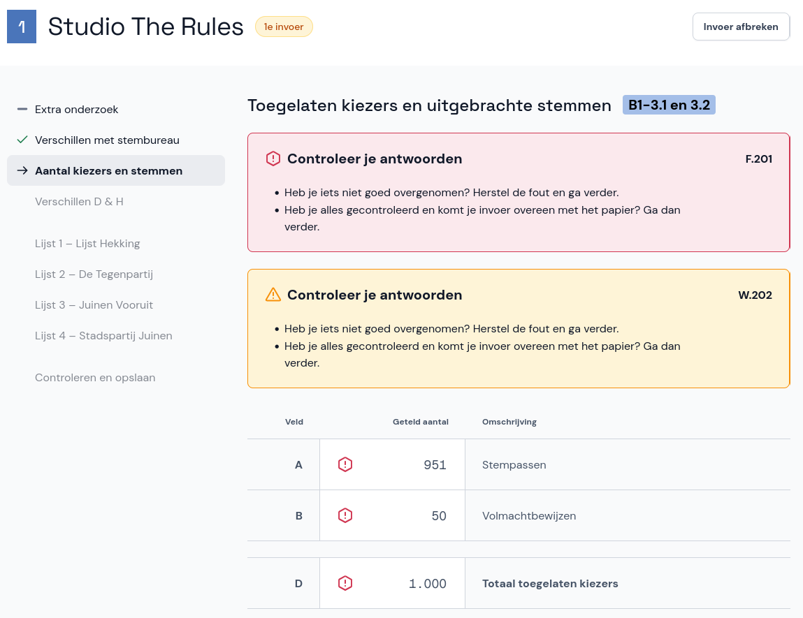
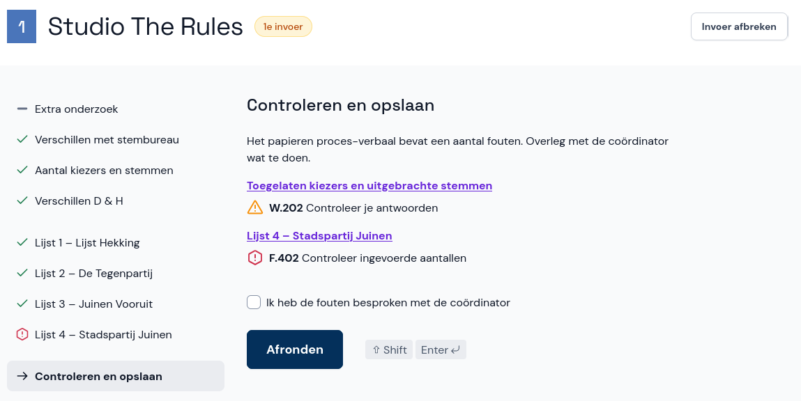

# Fouten en waarschuwingen

Het kan zijn dat je een fout of waarschuwing krijgt tijdens de invoer of bij de stap *Controleren en opslaan*. Er wordt je dan gevraagd om te controleren op fouten. Bij waarschuwingen en fouten doe je het volgende:

## Tijdens de invoer

Controleer of je het papieren proces-verbaal goed hebt overgenomen en herstel eventueel je invoer. Abacus laat duidelijk zien welke velden je extra moet controleren.

> <i class="fa-solid fa-circle-exclamation"></i> **Let op**
>
> Je mag het papieren proces-verbaal nooit aanpassen, ook niet als je fouten ziet. Neem de invoer precies over zoals het op het papier staat.

Als alles klopt vink je aan dat je de invoer hebt gecontroleerd met het papier en correct hebt overgenomen. Je kunt dan doorgaan naar de volgende pagina.

In het algemeen geldt: als je niet zeker weet wat je moet doen, overleg dan met je coördinator.

  
*Een voorbeeld van een fout en een waarschuwing tijdens de invoer*

## Bij Controleren en opslaan

Controleer of je het papieren proces-verbaal goed hebt overgenomen en herstel eventueel je invoer. Met de link boven de waarschuwing of fout ga je naar de plek waar deze voorkomt, en Abacus laat duidelijk zien welke velden je extra moet controleren.

> <i class="fa-solid fa-circle-exclamation"></i> **Let op**
>
> Je mag het papieren proces-verbaal nooit aanpassen, ook niet als je fouten ziet. Neem de invoer precies over zoals het op het papier staat.

Klopt je invoer, maar is de fout of waarschuwing nog zichtbaar? Bespreek de fouten dan eerst met je coördinator. Daarna zet je het vinkje aan en kun je de invoer afronden.

  
*Een voorbeeld van een fout en een waarschuwing bij Controleren en opslaan*
