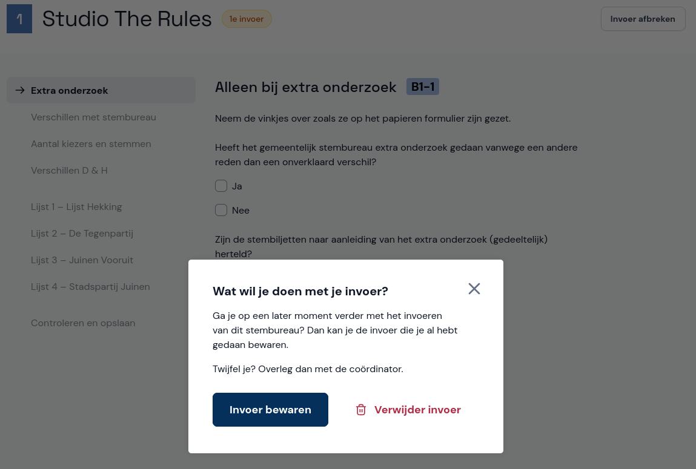

# Pauzeren of afbreken

Als je pauze neemt, kun je de invoer bewaren via de knop **Invoer afbreken** rechtsboven.
Na je pauze selecteer je onder **Je hebt nog een openstaande invoer** het stembureau en kun je doorgaan waar je gebleven was.

Als je de invoer wil afbreken en weggooien, bijvoorbeeld omdat je opnieuw wil beginnen, kun je er ook voor kiezen om de invoer te verwijderen.

